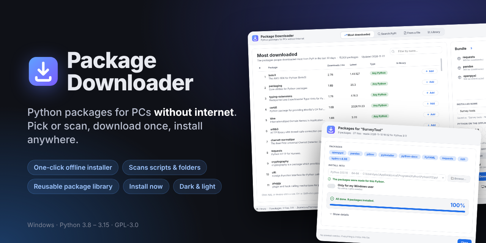
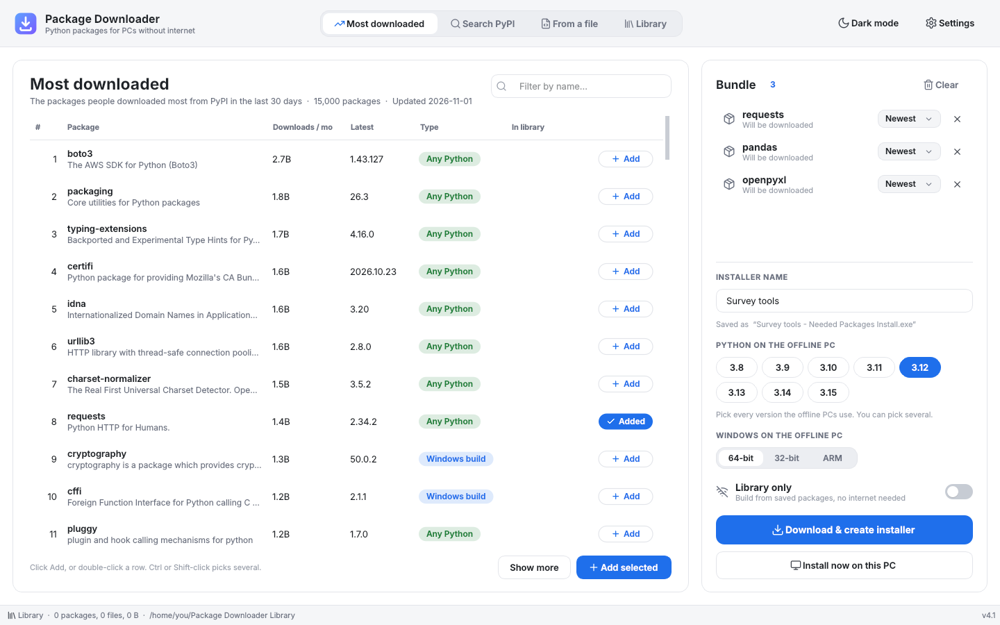
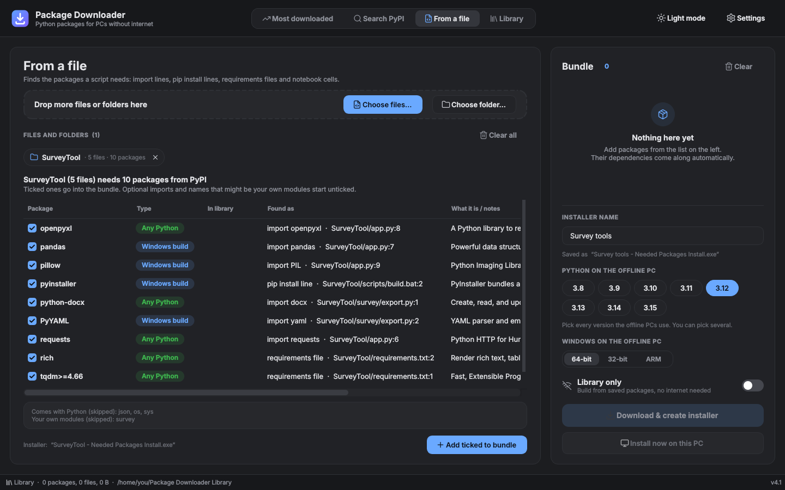
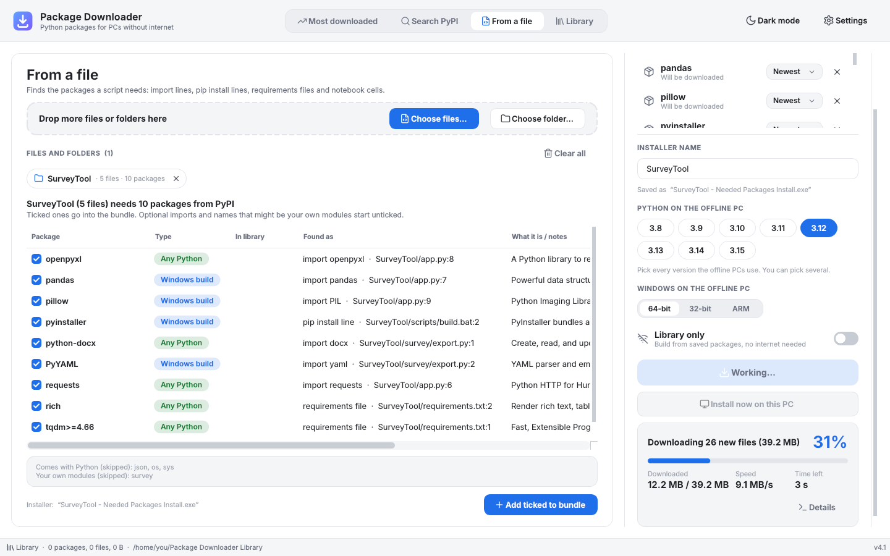
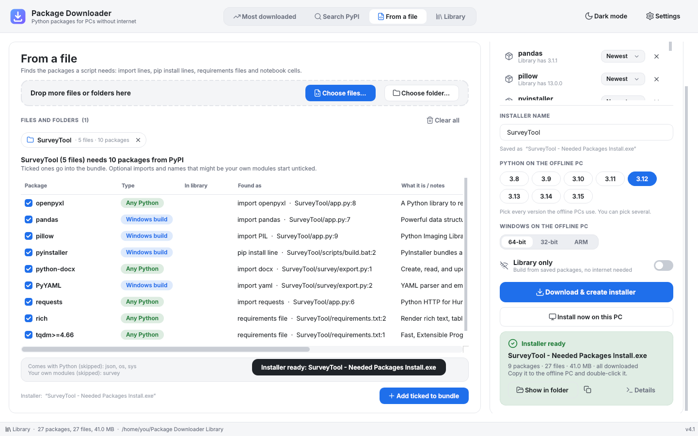
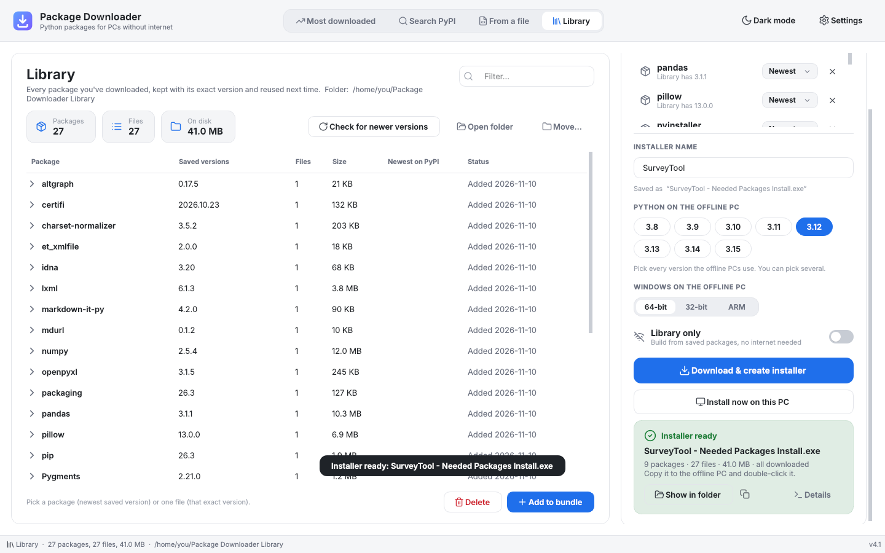
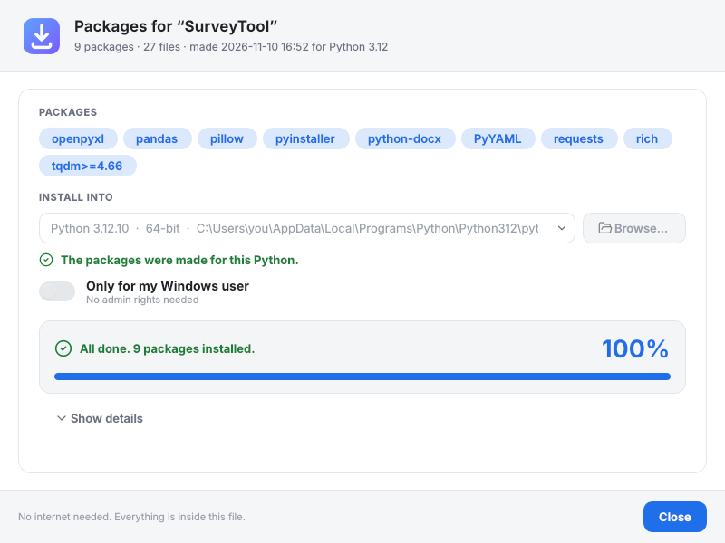
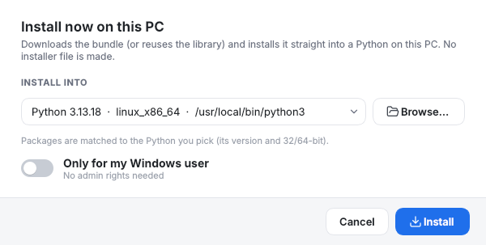
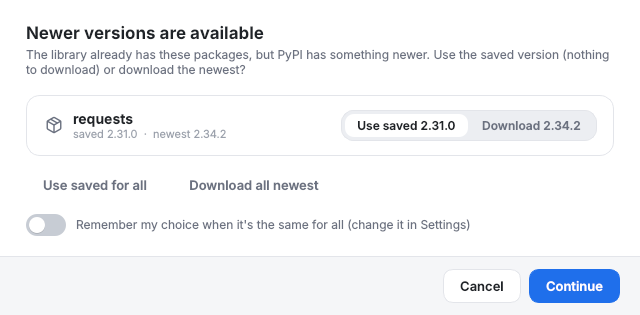
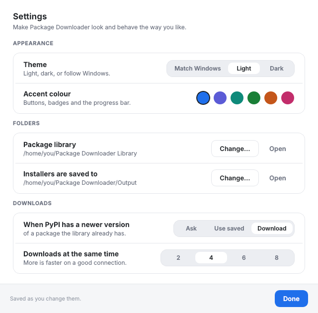

<p align="center">
  
</p>

<h1 align="center">Package Downloader</h1>

<p align="center">
  <b>Get Python packages onto a Windows PC that has no internet.</b><br>
  Pick packages (or scan your scripts), download them once on a PC with internet,<br>
  and get one <code>… - Needed Packages Install.exe</code> that installs everything offline.
</p>

<p align="center">
  
  
  
  
</p>

<p align="center">
  <a href="https://github.com/sliver301/Py-Package-Downloader/releases/latest"></a>
  <br>
  <sub>Latest release · Windows 10/11 · no install needed, just run the exe</sub>
</p>

---

## Why

**Got code from an AI and just want it to run?** You don't need to know what `requests`, `openpyxl` or `PIL` are, or which ones the script needs. Drop the script (or the whole project folder) into Package Downloader and it reads the code, works out every package it imports, and gets them for you. Click **Install now on this PC** and the code is ready to run. Do it again every time the AI hands you a new version, and nothing goes missing.

**Need it on a PC without internet?** Locked-down or air-gapped PCs can't run `pip install`. Copying packages by hand means chasing every dependency, matching the right Python version and Windows build, and hoping nothing is missing. Package Downloader does all of that for you:

1. On a PC **with** internet, pick what you need: from PyPI's most downloaded list, a PyPI search, or a scan of your own scripts and folders.
2. It resolves every dependency **for the offline PC's exact Python version and Windows type**, and downloads only ready-made builds (wheels).
3. You get a single installer exe. Double-click it on the offline PC: it finds Python and installs everything, no internet needed.

## Features

- **Most downloaded / Search PyPI.** Browse PyPI's top packages of the last 30 days or search every package name, then click **Add**.
- **From a file or folder.** Drop `.py`, `.pyw`, `.bat`, `.ps1`, `.ipynb` or `requirements.txt` files, or a whole folder. It finds `import` lines and real `pip install` commands, maps import names to PyPI names (`cv2` → opencv-python, `PIL` → Pillow, `win32com` → pywin32, …), skips the standard library, your own modules and host-program modules (Revit, Dynamo, Rhino, …), and marks optional imports.
- **One-file offline installer.** `<name> - Needed Packages Install.exe` picks the matching Python on the offline PC, installs with no internet, and can run silently (`--yes`).
- **Install now on this PC.** Skip the installer and install the bundle straight into a Python on the current PC, pinned to the exact versions it resolved.
- **Package library.** Every downloaded file is kept (with its checksum) and reused next time. It asks whether to use a saved version or download a newer one. **Library only** mode builds installers with no internet at all.
- **Progress you can read.** Percent, size, speed and time left while downloading.
- **Light and dark mode**, accent colours, follows the Windows theme.

## Screenshots

| Pick packages | Scan a whole folder |
|---|---|
|  |  |
| **Downloading with speed and time left** | **Installer ready** |
|  |  |
| **The package library** | **The offline installer** |
|  |  |

<details>
<summary>More screenshots</summary>

| Install now on this PC | Newer version prompt | Settings |
|---|---|---|
|  |  |  |

</details>

## Quick start

### Download
Get **`Package Downloader.exe`** from the [latest release](https://github.com/sliver301/Py-Package-Downloader/releases/latest) and double-click it. It's a single file: nothing to install, and it brings its own pip.

### Run from source
Needs Python 3.8+ on Windows.

```bat
"Run Package Downloader.bat"
```

It finds Python, installs PySide6 (`PySide6-Essentials`) if it's missing, and opens the app. Running from source makes a `.zip` with an `Install.bat` instead of an `.exe`.

### Build the exe
```bat
"Build EXE.bat"
```

It picks a Python that has PySide6, installs PyInstaller if needed, and writes `Package Downloader.exe` next to the script. **Build it on the offline PC if you can**: the exe then remembers that PC's Python version and marks it with ★ as the default target. Then copy the exe to the PC with internet.

If the build PC has no internet, put PyInstaller's wheels in a `PyInstaller offline\wheels` folder with a `requirements.txt` next to it, and `Build EXE.bat` installs from there. You can make that folder with Package Downloader itself: add `pyinstaller`.

## On the offline PC

Double-click `… - Needed Packages Install.exe`. It finds Python (py launcher, PATH, the usual install folders), picks the one the packages were made for and installs. If none matches it lets you choose, or **Browse…** to `python.exe`.

Command line options:

| Option | What it does |
|---|---|
| `--yes` | Silent install. The log goes to `%TEMP%`. |
| `--python "C:\path\python.exe"` | Install into this Python. |
| `--user` | Install for the current Windows user only (no admin rights). |
| `--extract FOLDER` | Just unpack the wheels and `Install.bat`. |

You can also drag an installer onto `Package Downloader.exe` to install it.

## How it works

- **Resolving.** The bundled pip runs `pip install --dry-run --report` with `--platform`, `--python-version`, `--abi` and `--only-binary=:all:` for each target Python, so dependencies are resolved for the offline PC, not the one you're on. The app then downloads the wheel files itself (in parallel, with progress) and checks their hashes.
- **The library** lives in `Documents\Package Downloader Library\Packages` (or `%USERPROFILE%\Package Downloader Library` when Documents is synced to OneDrive). `library.json` lists each file's name, version, sha256 and date.
- **The installer** is a copy of `Package Downloader.exe` with the wheels appended as a payload. When the exe finds a payload, it opens the installer window instead of the downloader. It installs with `pip install --no-index --find-links`, and adds pip from the bundle if the offline Python has none.
- **The code.** `package_downloader.py` holds all the logic and uses only the standard library. `package_downloader_ui.py` holds the PySide6 windows. Keep the two files together.

## Good to know

- Only wheels are downloaded, because the offline PC can't compile anything. Packages that only publish source code are marked **source only**.
- Each installer is about 40 MB larger than its packages, because it carries the app and its window toolkit.
- Windows SmartScreen may warn about a self-built, unsigned exe. Click **More info → Run anyway**.
- Settings are stored in `%LOCALAPPDATA%\Package Downloader\settings.json`.

## 🤖 Made with AI

This app is about 99% vibe-coded: I described what I wanted, tested it on my own PC, and an AI assistant (Claude) wrote the code. It works great for me every day, but it hasn't been through a formal code review. Bug reports and pull requests are very welcome.

## License

Copyright (C) 2026 Package Downloader contributors.

This program is free software: you can redistribute it and/or modify it under the terms of the **GNU General Public License** as published by the Free Software Foundation, either **version 3** of the License, or (at your option) any later version. See [LICENSE](LICENSE).

The built exe bundles [pip](https://pip.pypa.io) (MIT) and [PySide6 / Qt](https://www.qt.io/qt-for-python) (LGPL-3.0).
